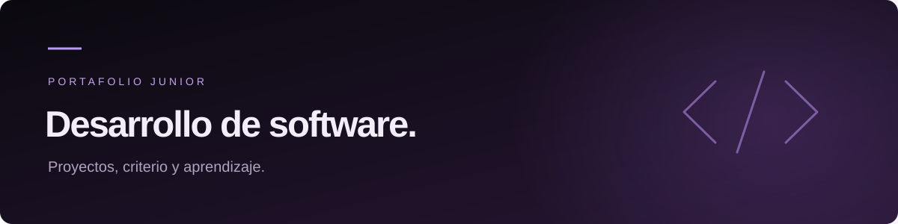

Estudiante de **Ingeniería en Ciberseguridad en INACAP**, cursando el último año correspondiente a la salida intermedia de **Analista Programador**. Busco mi primera oportunidad en desarrollo de software junior, con interés en trabajo remoto desde Chile.

[Explorar portafolio](https://bastiiiuuu.github.io) · [Currículum](https://bastiiiuuu.github.io/curriculum.html)

### Proyectos para explorar

| Proyecto | Qué contiene | Enlaces |
| --- | --- | --- |
| **Mis Reinas** | Aplicación académica con Django, ofertas, categorías y sucursales relacionadas; API JSON de consulta, filtros y pruebas. | [Código y arquitectura](https://github.com/bastiiiuuu/Misreinas) · [Caso de estudio](https://bastiiiuuu.github.io/proyectos/misreinas.html) |
| **Gestor de tareas** | React, CRUD en el navegador, búsqueda y persistencia con recuperación ante datos inválidos. | [Código](https://github.com/bastiiiuuu/Certamen-4) · [Demo](https://bastiiiuuu.github.io/Certamen-4/) |
| **Calculadora de notas** | Promedios ponderados, validación y estimación de una nota mínima sin redondear por debajo del objetivo. | [Código](https://github.com/bastiiiuuu/calculadora-notas-10-pts) · [Demo](https://bastiiiuuu.github.io/calculadora-notas-10-pts/) |
| **Atlas de anatomía** | Visualización 3D con Three.js y backend local FastAPI. Proyecto desarrollado con apoyo de IA y modelos de terceros con atribuciones. | [Código](https://github.com/bastiiiuuu/anatomia-mvp) · [Demo](https://bastiiiuuu.github.io/anatomia-mvp/) |

### Tecnologías presentes en estos proyectos

**Interfaces:** JavaScript, React, HTML y CSS.  
**Servidor y datos:** Python, Django y SQLite; FastAPI en la edición local del atlas.  
**Verificación:** node:test, unittest, ESLint y GitHub Actions.

Los repositorios incluyen instrucciones de instalación, límites y casos de prueba. La presencia de una tecnología muestra su uso en un proyecto, sin convertirla en una afirmación de dominio profesional.

### Cómo trabajo y aprendo

Me interesa entender la lógica antes de ampliar una aplicación, documentar las decisiones y comprobar los casos que pueden fallar. Utilizo apoyo de IA y recursos externos cuando corresponde, conservando sus créditos y contrastando el resultado con pruebas. El atlas se presenta expresamente como un proyecto con apoyo de IA.

Los proyectos académicos y personales de este perfil no se presentan como experiencia laboral. El portafolio reúne el contexto y los enlaces para revisar el código.
